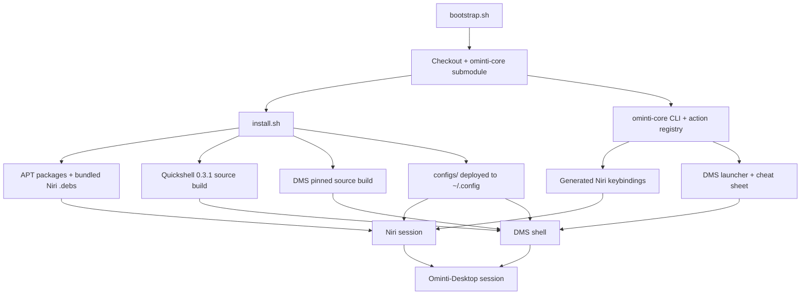

# Ominti-Desktop

**A keyboard-first, action-driven Wayland desktop for Debian 13 and LMDE 7.**

Ominti-Desktop is a complete desktop you can install in one command: **Niri** as
the compositor, **DankMaterialShell (DMS)** as the shell, and a small CLI and
action registry that make everything discoverable, scriptable and
keyboard-driven. It is built and validated on **LMDE 7 / Debian 13**, and
supports Ubuntu-family systems through the same source-build path.

> **New to the project?** Start with [What you get](#what-you-get) and the
> [60-second quick start](#quick-start). If you want to understand how the
> pieces fit together, read [How it works](#how-it-works).

---

## Why Ominti-Desktop?

- **Keyboard-first.** Every surface has a shortcut, and `Super+K` opens a
  searchable list of every action. The mouse is optional, not required.
- **One action registry.** Actions are declared once in
  [`ominti-core`](https://github.com/MartinKnights/ominti-core); the desktop
  generates the Niri keybindings, the launcher entries and the cheat sheet from
  that single source of truth.
- **Reproducible.** Quickshell and DMS are built from pinned commits, and the
  installer verifies the shell after building it instead of leaving you with a
  crash loop.
- **Agent-installable.** The repository doubles as an instruction manual for an
  AI agent: assessment, questions, plan, install, verification, report. A human
  can run the same commands.
- **Debian-native.** No separate ISO and no custom kernel: it is a layer on a
  normal Debian 13 / LMDE 7 install, using APT, systemd and your existing user
  account.

### What it adds over a manual Niri + DMS install

| Manual setup | Ominti-Desktop |
| --- | --- |
| Build Quickshell and DMS yourself | Pinned, validated builds with a shell smoke test |
| Hand-write Niri bindings and launcher entries | One action registry generates both |
| Install each surface separately | Six surfaces, a terminal profile and helper scripts |
| Remember the order of operations | One idempotent installer with `--dry-run` and backups |
| Debug a broken shell from scratch | Diagnostics, verification scripts and a symptom index |
| Write your own install notes for an agent | `AGENTS.md` plus install/upgrade runbooks |

## Is it for you?

**Good fit**

- You run Debian 13 (trixie) or LMDE 7 (gigi) and want a modern, keyboard-first
  Wayland desktop.
- You are comfortable with a terminal and with editing configuration files.
- You want a desktop that an AI agent can install and maintain with clear
  guardrails.
- You are happy to start from a clean install or migrate an existing desktop
  deliberately.

**Not a good fit**

- You need a turnkey ISO or a distribution with its own installer. Ominti-Desktop
  installs *on top of* Debian/LMDE; it is not a distro.
- You want a mouse-first, settings-app-driven desktop.
- You need a supported path on Debian 12 / LMDE 6 (it is refused: no
  `trixie-backports`).
- You need ARM or a non-Debian distribution today.

## What you get

| Surface | Key | What it does |
| --- | --- | --- |
| **Omi Media** | `Shift+Alt+M` | Playlist launcher — one tab per folder, type to filter, Enter to play |
| **Omi Dictionary** | `Ctrl+Shift+A` | Offline dictionary and thesaurus for the selected word |
| **Omi Reader** | `Super+Alt+O` | Read a document aloud (Piper), with a transport panel |
| **Omi Reader** (clipboard) | `Shift+Alt+S` | Read the clipboard aloud |
| **Omi Dictation** | `Super+Alt+T` | Speech to text, typed into the focused window (whisper.cpp) |
| **Omi Capture** | `Ctrl+Alt+R` | OCR — select an area, get the text on the clipboard |
| **Omi Scripts** | `Super+S` | Script launcher / control panel |
| Interaction explorer | `Super+K` | Browse and run every action |
| Universal palette | `Super+Space` | Apps **and** actions together |
| Cheat sheet | `Super+Shift+S` | Tabbed keybinding reference |
| AI menu | `Super+A` | Ask AI / open Pi |
| Power menu | `Super+X` | Restart audio/network, reload Niri, power controls |
| Wallpaper carousel | `Super+Ctrl+P` | Browse and apply wallpapers |

The canonical name of every surface is in [docs/NAMING.md](docs/NAMING.md).

### A typical session

1. Log in and choose the **Niri** session. The DMS bar appears at the top.
2. Press `Super+K` and type `terminal` — the interaction explorer filters every
   registered action, not just applications.
3. Open **Omi Media** with `Shift+Alt+M`, pick a playlist folder, type to
   filter and press Enter.
4. Select a word anywhere and press `Ctrl+Shift+A` for the offline dictionary.
5. Press `Super+Alt+O` to have a document read aloud, or `Super+Alt+T` to
   dictate into the focused window.
6. Press `Super+Space` when you do not remember a shortcut: applications and
   actions are searchable in the same palette.

Every one of those paths goes through the same action registry, so the
cheat sheet (`Super+Shift+S`) and the actual keybindings cannot drift apart.

## Quick start

**You need:** Debian 13 (trixie) or LMDE 7 (gigi), x86_64, `sudo`, `git`,
`curl`, `gpg`, `python3`, about **10 GB free**, and a network connection. Expect
**20–40 minutes** on the first install (two source builds); a re-run takes a few
minutes.

```sh
curl -fsSLO https://raw.githubusercontent.com/MartinKnights/Ominti-Desktop/main/bootstrap.sh
bash bootstrap.sh          # resumable: re-run it if the download drops
cd ~/Ominty
./install.sh --dry-run     # read the plan first
./install.sh
```

Log out, choose the **Niri** session at the display manager, and log in.

`bootstrap.sh` fetches the checkout in retryable pieces (metadata, source,
submodule, then the bundled `.deb`s). If the `.deb` downloads are a problem,
supply them locally:

```sh
OMINTY_PACKAGES_SRC=/media/usb/Ominty/packages bash bootstrap.sh
```

<details><summary>Prefer a plain git clone?</summary>

```sh
git clone --recurse-submodules https://github.com/MartinKnights/Ominti-Desktop.git Ominty
cd Ominty
```
</details>

The full guide — requirements, options, expected output and post-install
checks — is [docs/INSTALL.md](docs/INSTALL.md).

## Two ways to install

### Do it yourself

Follow the quick start above. The installer is idempotent: it backs up existing
configuration as `.bak-ominty-<timestamp>`, deploys the new configuration, and
can be re-run safely. Start with `--dry-run`; it prints every command it would
run and changes nothing.

### Let your AI do it

Copy this into an agent (Claude Code, opencode, Codex, Cursor — anything with
shell access):

> You are setting up Ominti-Desktop on this machine. Read `AGENTS.md`, then
> follow `docs/AGENT-INSTALL.md` end to end. Do the read-only assessment and ask
> me the required questions first, then show me the plan for my approval. Stop
> if a gate fails. After the first login, run the verification scripts and tell
> me what still needs me.

The agent reads the repository as its instructions — assessment, questions,
plan, install, verification, report. More prompts (upgrade, repair) and the
rules it must follow: [docs/PROMPTS.md](docs/PROMPTS.md).

## How it works



| Piece | Where it comes from | Why it matters |
| --- | --- | --- |
| Niri | Bundled `.deb` in `packages/` | A scrollable-tiling Wayland compositor |
| Quickshell | **Built from pinned `v0.3.1`** | The DMS shell is validated against this build |
| DMS | **Built from a pinned commit** with the motion + accent-glow overlay | Every machine runs the same shell |
| matugen, ghostty | AvengeMedia Open Build Service | Wallpaper-driven theming and the Ghostty option |
| `ominty` CLI, action registry | [`ominti-core`](https://github.com/MartinKnights/ominti-core) submodule | One source of truth for actions and keybindings |
| DMS plugins | Six shipped here, 14 pinned by commit | Reproducible third-party integrations |

DMS is source-built on **both** Debian and Ubuntu families so every machine runs
the identical shell. That is what makes the overlay, the motion tuning and the
settings portable — and why the installer runs a shell smoke test and rolls back
rather than leaving a crash loop.

## Status and support

| Platform | Status |
| --- | --- |
| LMDE 7 (gigi) / Debian 13 (trixie), x86_64 | **Validated** — the reference target |
| Ubuntu 24.04-family, x86_64 | **Supported via source build** — see [UBUNTU.md](docs/UBUNTU.md) |
| Debian 12 / LMDE 6 | **Refused** — no `trixie-backports`; upgrade first |
| Other Debian-family systems | Untested; the installer warns and continues |
| ARM | Not supported yet |

Known constraints are documented in [TROUBLESHOOTING.md](docs/TROUBLESHOOTING.md)
and [HARDWARE.md](docs/HARDWARE.md). If you hit a new one, collect diagnostics
with `scripts/collect-diagnostics.sh` before changing anything, then open an
issue at
[github.com/MartinKnights/Ominti-Desktop/issues](https://github.com/MartinKnights/Ominti-Desktop/issues).

## Documentation

The documentation is organised by what you are trying to do. The full map is in
[docs/README.md](docs/README.md).

**I want to install or upgrade**

- [INSTALL.md](docs/INSTALL.md) — clean install, options, post-install checks, updates
- [MIGRATION.md](docs/MIGRATION.md) — assess and migrate an existing Cinnamon/GNOME desktop
- [TROUBLESHOOTING.md](docs/TROUBLESHOOTING.md) — symptom → check → fix

**I want an AI agent to do it**

- [AGENTS.md](AGENTS.md) — the contract every deploying agent follows
- [PROMPTS.md](docs/PROMPTS.md) — copy-paste prompts for install, upgrade and repair
- [AGENT-INSTALL.md](docs/AGENT-INSTALL.md) — agent-executable fresh install, with gates
- [AGENT-UPGRADE.md](docs/AGENT-UPGRADE.md) — agent-executable upgrade + friction report

**I want to understand it**

- [ARCHITECTURE.md](docs/ARCHITECTURE.md) — how the pieces fit together
- [NAMING.md](docs/NAMING.md) — the official name of every surface
- [GLOSSARY.md](docs/GLOSSARY.md) — Niri, DMS, Quickshell, action registry, layers, roles
- [INSPECT.md](docs/INSPECT.md) — every field of `ominty inspect --json`
- [FAQ.md](docs/FAQ.md) — common questions and expectations

**I want to maintain or extend it**

- [MAINTAINING.md](docs/MAINTAINING.md) — pins, lockfiles, patches, release checklist
- [HARDWARE.md](docs/HARDWARE.md) — supported hardware and profiles
- [STYLE.md](docs/STYLE.md) — documentation style guide
- [CONTRIBUTING.md](CONTRIBUTING.md) — how to propose and test a change

## Repository layout

```text
Ominti-Desktop/
├── AGENTS.md                  # contract for a deploying agent
├── install.sh                 # one-command installer (idempotent)
├── configs/                   # deployable configuration
│   ├── niri/                  #   compositor config
│   ├── dms/                   #   shell settings, plugin lock, overlay patch
│   ├── bin/ local-bin/ Scripts/  # helper scripts the keybindings call
│   └── systemd/               #   user units and drop-ins
├── omi-media/                 # Omi Media (CLI + DMS popup)
├── omi-dictionary/            # Omi Dictionary (CLI + DMS popup)
├── ominty-plugins/            # shipped plugins + patches for third-party ones
├── scripts/                   # build, verification, diagnostics, rollback
├── packages/                  # prebuilt .debs (niri, xwayland-satellite)
├── profiles/                  # optional hardware profiles
├── docs/                      # guides, runbooks, reference
└── ominty-core/               # CLI, action registry, adapters (submodule)
```

## Naming and compatibility

The product is **Ominti-Desktop**, and the two GitHub repositories are
[`Ominti-Desktop`](https://github.com/MartinKnights/Ominti-Desktop) (the desktop,
installer and configuration) and
[`ominti-core`](https://github.com/MartinKnights/ominti-core) (the CLI, action
registry and DMS plugins).

Technical identifiers keep their existing names so upgrades and scripts do not
break: the `ominty` CLI, `~/.config/ominty`, `OMINTY_*` environment variables,
the `~/Ominty` checkout directory, and the `ominty-core/` submodule path. The six
desktop surfaces use the short prefix **Omi** (`Omi Media`, `Omi Dictionary`, …).
When in doubt: **product = Ominti-Desktop; surfaces = Omi; runtime = ominty.**

## Contributing, security and license

- **Contributing:** [CONTRIBUTING.md](CONTRIBUTING.md) explains the workflow,
  tests and documentation rules.
- **Security:** [SECURITY.md](SECURITY.md) explains how to report a
  vulnerability privately.
- **License:** MIT — see [LICENSE](LICENSE). Third-party components keep their
  own licenses; the bundled Niri `.deb` is GPL-3.0.

## Project history

Ominti-Desktop began as **OmiVoid** and was later renamed **Ominty**. On
2026-11-13 the repositories and product name became **Ominti-Desktop** and
**ominti-core**. Old GitHub URLs redirect, and the technical identifiers above
were deliberately kept stable.
