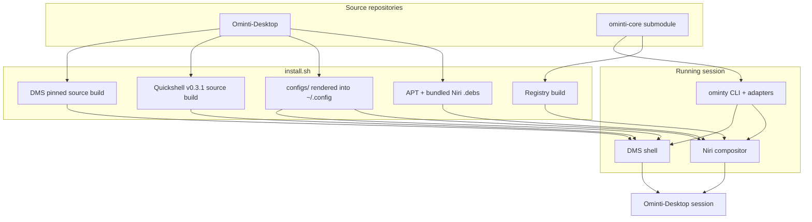

# Architecture

Ominti-Desktop is the **desktop and distribution layer**: it packages a
working, validated Niri + DMS desktop for Debian-family systems and installs it
with one idempotent script. The implementation — the CLI, the action registry,
the adapters and the DMS plugins — lives in the
[`ominti-core`](https://github.com/MartinKnights/ominti-core) submodule.

There are two repositories:

| Repository | Owns |
| --- | --- |
| [`Ominti-Desktop`](https://github.com/MartinKnights/Ominti-Desktop) | installer, bootstrap, deployable configuration, bundled `.deb`s, docs, profiles |
| [`ominti-core`](https://github.com/MartinKnights/ominti-core) | `ominty` CLI, action registry, adapters, inspect, DMS plugins |

## The whole system at a glance



The important split is:

- **Niri** owns windows, outputs, input and the session.
- **DMS** owns the visible desktop: bar, launcher, notifications, control
  centre, lock screen and plugins.
- **Quickshell** is the toolkit DMS is built on; the pinned build is part of the
  compatibility contract.
- **`ominty-core`** owns *what the desktop can do*: actions, roles, adapters and
  generated keybindings.
- **This repository** owns *how it is installed and configured*: packages,
  pinned builds, deployable files, hardware profiles and the installer.

## Core principle: the action registry is the source of truth

Every capability of the desktop is an **action** defined in the registry
(`ominty-core/actions/*.toml`). From the registry, the CLI:

1. **Validates** the registry (`ominty registry validate`).
2. **Generates** the Niri keybinding fragment
   (`ominty registry build` → `~/.config/ominty/generated/niri/bindings.kdl`).
3. **Runs** actions through adapters (`ominty action run <id>`).
4. **Serves** the DMS plugins (launcher entries, cheat-sheet rows).

No interaction surface hard-codes a command where a canonical action exists
(AGENTS.md Contract 3). That is what makes `Super+K`, the universal palette and
the cheat sheet agree with the actual keybindings.

A concrete example:

```sh
ominty action run app.terminal.open
```

The action resolves the `terminal` role from `~/.config/ominty/apps.toml` and
launches whatever that role points at. `Super+Enter` runs the same action, so
changing the role changes both paths at once.

## Adapters

Actions are performed by **adapters**, resolved platform → common:

| Adapter | Purpose |
| --- | --- |
| `common/app_launch` | Launch applications by role (`app.browser.open`) |
| `common/command` | Run a declared command (`adapter = "command"`) |
| `debian/service_restart` | systemd user services (`system.audio.restart`) |
| `debian/package_install` | `apt-get install` (`package.install`) |
| `niri/native` | Native Niri operations |
| `dms/ipc` | DMS IPC calls (spotlight, power menu) |
| `dms/theme` | Wallpaper → palette regeneration |

The **Void** adapters (`void/service_restart` via runit `sv`,
`void/package_install` via `xbps-install`) exist but are not exercised on
Debian — they are the porting surface for the separate Void install project.

## Configuration flow

```text
Ominti-Desktop/configs/  ──install.sh──▶  ~/.config/
├── niri/config.kdl                      ├── niri/config.kdl
├── niri/dms/*.kdl                       ├── niri/dms/*.kdl
├── dms/settings.json                    ├── DankMaterialShell/settings.json
├── dms/plugin_settings.json.tpl         ├── DankMaterialShell/plugin_settings.json
├── terminal/                            ├── starship.toml, zellij/, alacritty/, shell.bash
└── ominty/*.toml                        └── ominty/*.toml   (user config wins)
```

- Templates use `__HOME__` placeholders substituted at install time.
- Existing user configuration is **backed up**, never silently destroyed.
- User overrides in `~/.config/ominty/` win over shipped defaults.
- The installer is idempotent: a second run backs up only what changed and
  re-renders the same result.

## The installer

`install.sh` is deliberately a sequence of small, observable steps:

1. Resolve the layer manifest from `ominty-core` (single source of truth).
2. Add APT sources and pins, then install the selected layer packages.
3. Build Quickshell from the pinned tag, then DMS from the pinned commit.
4. Install Niri and xwayland-satellite from the bundled `.deb`s.
5. Deploy the configuration, terminal profile and helper scripts.
6. Generate the keybindings from the registry and install the DMS plugins.
7. Verify the shell, validate the registry and the Niri config.

Each step that builds or replaces something is either idempotent or has a
cached-pin check. The `--dry-run` path prints the same sequence without changing
anything.

## Hardware profiles

`profiles/<device>/` holds hardware-specific fragments (outputs, scripts).
The base config is hardware-agnostic; profiles are opt-in via
`./install.sh --profile <device>`. See [HARDWARE.md](HARDWARE.md).

## AI

The AI surface (`Super+A`) is a first-class interaction path:

- `ai.ask` runs through a provider layer (Pi or Ollama).
- AI actions respect registry policy: `ai_accessible`, `risk`,
  `confirmation`, `contexts`.
- `ai.*` actions are not re-exposed to AI (no recursion).
- AI is **optional** and configured last with `scripts/setup-ai.sh`; the desktop
  does not depend on a model download.

## Portability

The platform abstraction (`adapters/{debian,void}/`) isolates distribution
differences. The Void port is tracked in a separate install project and requires
xbps packaging, runit services and exercising the Void adapters. No
architectural change is expected for Debian-family systems.

## Where the design lives

- The current operating guides are in this repository under
  [`docs/`](README.md).
- The implementation's own records (assessment, OSKS, implementation notes) are
  in `ominty-core/docs/`.
- Historical design records and implementation reports are in
  [`docs/plans/`](plans/). When a plan and a current guide disagree, the
  current guide wins.
